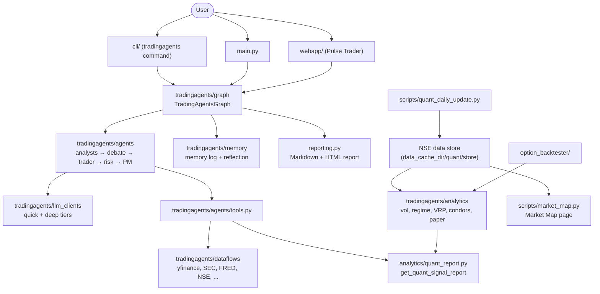

# System overview

> **Status:** Current.
> **Scope:** the whole repository: what each part is, where it lives, and how the parts fit together.
> **Last verified against the code:** 2026-10-24

---

## 1. What this project is

This repository is a fork of the open-source **TradingAgents** framework (package version `0.7.0`, set in
`tradingagents/__init__.py`). TradingAgents runs a team of LLM agents that study one ticker on one date and
end with a rating on a five-step scale: Buy, Overweight, Hold, Underweight, Sell.

The fork adds four things on top of the original:

1. **An India / NSE layer** — NSE-specific data tools, an NSE trading calendar, a SEBI-aware report disclaimer.
2. **An options backtester** — the engine from the separate optopsy project, moved in as `option_backtester/`.
3. **A quant signal layer** — deterministic statistics (no LLM) on a local NSE data store, with strict
   validation rules, a daily refresh job and paper trading.
4. **A web page** (`webapp/`, "Pulse Trader") that turns market data into a plain-English trade plan.

Everything here is research and decision support. It is not investment advice, and the code places no
orders: the user trades by hand.

## 2. Components

| Component | Path | What it does | Details |
|---|---|---|---|
| Agent graph | `tradingagents/graph/` | Builds and runs the LangGraph pipeline; `TradingAgentsGraph.propagate()` | [02](02-agent-pipeline.md) |
| Agents and tools | `tradingagents/agents/` | Analysts, researchers, managers, trader, risk debaters; the data tools they call | [03](03-agents-and-tools.md) |
| LLM clients | `tradingagents/llm_clients/` | One client per provider; quick and deep model tiers | [04](04-llm-providers-and-configuration.md) |
| Configuration | `tradingagents/default_config.py` | `DEFAULT_CONFIG` plus `TRADINGAGENTS_*` environment overrides | [04](04-llm-providers-and-configuration.md) |
| Memory log | `tradingagents/memory/` | Records each decision, settles it later against the market, writes a lesson | [05](05-memory-reflection-and-checkpoints.md) |
| Checkpoints | `tradingagents/graph/checkpointer.py` | Optional resume of a crashed run (SQLite) | [05](05-memory-reflection-and-checkpoints.md) |
| Data vendors | `tradingagents/dataflows/` | Routes each data request to yfinance, Alpha Vantage, SEC EDGAR, FRED, Polymarket, Reddit, StockTwits, NSE | [06](06-data-vendors.md) |
| India layer | `tradingagents/dataflows/vendors/nse/`, `tradingagents/compliance.py` | NSE calendar, FII/DII flows, F&O contract facts, delivery data, index-volume repair, report disclaimer | [07](07-india-market-layer.md) |
| Options backtester | `option_backtester/`, `tradingagents/integrations/optopsy/` | Option strategies, signals, exits, metrics, simulator; NSE bhavcopy adapter | [08](08-option-backtester.md) |
| CLI | `cli/` | The `tradingagents` command (interactive or by flags), `backtest`, `login`, `logout` | [09](09-cli-webapp-and-reports.md) |
| Web page | `webapp/` | FastAPI app "Pulse Trader"; can start a TradingAgents run on Azure OpenAI as a background job | [09](09-cli-webapp-and-reports.md) |
| Reports | `tradingagents/reporting.py`, `tradingagents/report_html.py` | Markdown report tree and one-page HTML report | [09](09-cli-webapp-and-reports.md) |
| Decision backtest | `tradingagents/backtest.py` | Runs the graph over a grid of tickers and dates and scores the ratings | [12](12-evaluation-and-validation.md) |
| Quant layer | `tradingagents/analytics/`, `scripts/quant_*.py` | NSE store, volatility and regime models, option-strategy simulators, costs, validation, paper trading | [10](10-quant-layer-overview.md) |

The options backtester is licensed AGPL-3.0 (see `option_backtester/LICENSE`); the rest of the repository is
Apache-2.0 (from `README.md`).

## 3. How the parts fit together

In words:

- **The agent side** (sections 4–5) is the original framework plus India tools. One run = one ticker on one
  date = many LLM calls = one rating.
- **The quant side** (section 6) never calls an LLM. It builds its own data store from NSE files and produces
  numbers (volatility forecasts, market regime, implied volatility) with a validation status.
- **The bridge** between them is one tool, `get_quant_signal_report`: the Market Analyst can read the quant
  numbers as of the analysis date, and the saved report gets a "VI. Quant Context" section when the ticker is
  in the quant universe ([16](16-quant-context-in-agents.md)).

## 4. The original agent pipeline

The pipeline is a LangGraph state graph ([02](02-agent-pipeline.md)):

1. **Analysts** (run at the same time): Market, Sentiment, News, Fundamentals. Each writes one report.
2. **Research debate**: Bull Researcher and Bear Researcher argue in turns.
3. **Research Manager** (deep model) judges the debate and writes an investment plan with a rating.
4. **Trader** turns the plan into a Buy / Hold / Sell proposal with entry, stop-loss and sizing when it can.
5. **Risk debate**: Aggressive, Conservative and Neutral analysts argue about the trader's plan.
6. **Portfolio Manager** (deep model) reads the risk debate and past lessons and gives the final rating.

A **Memory Log** step runs beside the analysts: it settles earlier decisions whose holding window has passed
and hands their lessons to the Portfolio Manager ([05](05-memory-reflection-and-checkpoints.md)).

## 5. India / NSE extensions on the agent side

- Four NSE tools in `tradingagents/agents/tools.py`: `get_india_fii_dii_flows`, `get_india_fo_contract_info`,
  `get_india_delivery_data` and `get_india_index_data_health`. For instruments not listed on NSE they answer
  "not applicable". A fifth tool, `get_quant_signal_report`, reads the quant layer.
- `.NS` tickers are scored against `^NSEI` and `.BO` tickers against `^BSESN` when a decision is settled
  (`benchmark_map` in `tradingagents/default_config.py`).
- Every complete report ends with a SEBI-aware disclaimer and flags phrases such as "guaranteed returns"
  without rewriting them (`tradingagents/compliance.py`).

Details: [07](07-india-market-layer.md).

## 6. The quant signal layer

`tradingagents/analytics/` holds the deterministic modules; `scripts/quant_*.py` are their command-line entry
points. In outline:

| Topic | Main modules | Document |
|---|---|---|
| NSE data store, prices, quotes, universe | `datastore.py`, `backfill.py`, `prices.py`, `quotes.py`, `universe.py` | [11](11-nse-data-store.md) |
| Evaluation, validation gates, holdout, trial log, replay checks, causal chart patterns | `evaluate.py`, `validation.py`, `gates.py`, `holdout.py`, `trial_log.py`, `replay_check.py`, `swings.py` | [12](12-evaluation-and-validation.md) |
| Volatility and regime models | `volatility_model.py`, `chronos_vol.py`, `implied_vol.py`, `regime.py`, `vrp.py` | [13](13-volatility-and-regime-models.md) |
| Option strategy simulators and costs | `condor.py`, `quiet_condor.py`, `events.py` (results-day iron butterfly), `costs.py`, `sizing.py`, `stress.py` | [14](14-option-strategy-simulators-and-costs.md) |
| Daily refresh and paper trading | `paper.py`, `paper_strategies.py`, `scripts/quant_daily_update.py` | [15](15-daily-refresh-and-paper-trading.md) |
| Quant context in the agents | `quant_report.py` | [16](16-quant-context-in-agents.md) |
| Market Map page | `scripts/market_map.py` (reads `datastore.py`, `prices.py`, `universe.py`) | [17](17-market-map.md) |

The trade journal (`tradingagents/analytics/journal.py`, `scripts/trade_journal.py`) analyses the user's own
exported tradebook locally; no trade data is stored in the repository.

A short non-technical summary of the whole system is in [18](18-executive-summary.md).

## 7. Where things are written

| What | Default location |
|---|---|
| Run logs and saved reports | `results_dir` = `~/.tradingagents/logs` (`TRADINGAGENTS_RESULTS_DIR`) |
| Data cache, checkpoints, quant store | `data_cache_dir` = `~/.tradingagents/cache` (`TRADINGAGENTS_CACHE_DIR`) |
| Memory log | `~/.tradingagents/memory/trading_memory.md` (`TRADINGAGENTS_MEMORY_LOG_PATH`) |
| Market Map page | `reports/market_map/india-market-map.html` (gitignored; it embeds NSE data) |
