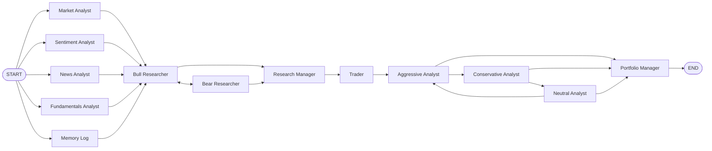

# Agent pipeline

> **Status:** Current.
> **Scope:** the LangGraph graph in `tradingagents/graph/`, the shared state in `tradingagents/agents/state.py`,
> node order, debate rounds, and what `propagate()` returns.
> **Last verified against the code:** 2026-10-24

---

## 1. Files

| File | Role |
|---|---|
| `tradingagents/graph/trading_graph.py` | `TradingAgentsGraph`: builds the LLMs, memory log, graph; runs `propagate()`; writes the state log |
| `tradingagents/graph/setup.py` | `GraphSetup.setup_graph()`: adds the nodes and edges; `_analyst_graph()` builds each analyst's own sub-graph |
| `tradingagents/graph/analyst_execution.py` | `ANALYST_NODE_SPECS`: analyst key → node name, report key, tool list |
| `tradingagents/graph/conditional_logic.py` | `ConditionalLogic`: who speaks next in each debate, and when a debate ends |
| `tradingagents/graph/propagation.py` | `Propagator`: the initial state and the invoke arguments (recursion limit) |
| `tradingagents/graph/checkpointer.py` | Optional SQLite checkpoints ([05](05-memory-reflection-and-checkpoints.md)) |
| `tradingagents/agents/rating.py` | Reads the 5-tier rating from a decision; the `REVIEW` sentinel |

There is no separate "signal processing" module in this version: the rating comes straight from the Portfolio
Manager's structured output, with `rating.py` as the fallback reader of free text.

## 2. Node order

From `GraphSetup.setup_graph()`:

1. Every selected analyst node and the **Memory Log** node start from `START` at the same time.
   `workflow.add_edge(first_steps, "Bull Researcher")` makes the Bull Researcher wait until all of them finish.
2. Each analyst is a sub-graph of its own (`_analyst_graph`): `agent` → `tools` (a LangGraph `ToolNode`) →
   `agent` … until the model stops calling tools. After `max_tool_rounds` rounds of tool calls a `wrap_up`
   step tells it to write its report, and that turn ends it. The sub-graph returns only its report key, so
   analysts running side by side never write the same state key. The Sentiment Analyst has no tools; its
   sub-graph is a single `agent` step.
3. Bull and Bear alternate, routed by `ConditionalLogic.should_continue_debate`, then the Research Manager.
4. Research Manager → Trader → Aggressive Analyst (fixed edges).
5. Aggressive → Conservative → Neutral → Aggressive …, routed by `should_continue_risk_analysis`, then the
   Portfolio Manager → `END`.

Analysts are chosen with `selected_analysts` (default `("market", "social", "news", "fundamentals")`).
`"social"` is the key for the Sentiment Analyst. At least one analyst must be selected. The CLI drops the
Fundamentals Analyst for crypto tickers (`cli/prompts.py`, `filter_analysts_for_asset_type`).

## 3. Debate rounds

| Setting | Default | Rule in `conditional_logic.py` |
|---|---|---|
| `max_debate_rounds` | 1 | Research Manager once `investment_debate_state["count"] >= 2 * max_debate_rounds` |
| `max_risk_discuss_rounds` | 1 | Portfolio Manager once `risk_debate_state["count"] >= 3 * max_risk_discuss_rounds` |
| `max_tool_rounds` | 20 | Tool rounds per analyst before `wrap_up` |
| `max_recur_limit` | 100 | LangGraph `recursion_limit`; must exceed `2 * max_tool_rounds + 2` or `__init__` raises `ValueError` |

So with defaults the Bull and Bear speak once each and each risk analyst speaks once. Who speaks next is read
from the speaker label at the start of the last argument ("Bull Analyst: …", `latest_speaker` "Aggressive",
"Conservative", "Neutral"). Every router's path map lists all its possible targets (`DEBATE_PATH_MAP`,
`RISK_ANALYSIS_PATH_MAP`), so an unexpected label cannot crash the graph.

## 4. The shared state (`AgentState`)

`AgentState` extends LangGraph's `MessagesState` (so it has `messages`). Fields:

| Field | Written by |
|---|---|
| `company_of_interest`, `asset_type`, `trade_date`, `instrument_context`, `portfolio_context` | Initial state (`Propagator.create_initial_state`) |
| `market_report`, `sentiment_report`, `news_report`, `fundamentals_report` | The four analysts |
| `past_context`, `memory_note` | Memory Log step |
| `investment_debate_state` (`InvestDebateState`) | Bull, Bear, Research Manager |
| `investment_plan` | Research Manager |
| `trader_investment_plan` | Trader |
| `risk_debate_state` (`RiskDebateState`) | Aggressive, Conservative, Neutral, Portfolio Manager |
| `final_trade_decision`, `final_rating` | Portfolio Manager |

`InvestDebateState`: `bull_history`, `bear_history`, `history`, `current_response`, `count`.
`RiskDebateState`: `aggressive_history`, `conservative_history`, `neutral_history`, `history`,
`latest_speaker`, `current_aggressive_response`, `current_conservative_response`,
`current_neutral_response`, `count`.

`instrument_context` is built once at the start by `resolve_instrument_context()`: a cached yfinance lookup of
the company name (and, for a current-date run, sector, industry and exchange), so every agent refers to the
right company. For a historical date only the current name is given, marked as such.

## 5. How `propagate(ticker, date)` runs

`TradingAgentsGraph.propagate(company_name, trade_date, asset_type="stock", portfolio=None)`:

1. `_validate_trade_date` — the date must be `YYYY-MM-DD` and not in the future, else `ValueError`.
2. `run_config(self.config)` makes this graph's config the one every tool call sees.
3. `checkpoint_scope(...)` — if `checkpoint_enabled`, recompiles the graph with a per-ticker `SqliteSaver` and
   decides whether to resume ([05](05-memory-reflection-and-checkpoints.md)).
4. `create_run_state(...)` builds the initial state (identity context, optional portfolio block).
5. `graph.invoke(...)`, or with `debug=True`, `stream_run(...)` which prints each message once.
6. `record_decision(...)` writes the state log JSON and appends the decision to the memory log.
7. `clear_checkpoint_on_success(...)` deletes this run's checkpoint.

It returns `(final_state, signal)`. `signal` comes from `run_rating(final_state)`: the Portfolio Manager's
`final_rating`, else the rating read from `final_trade_decision`. It is one of `Buy`, `Overweight`, `Hold`,
`Underweight`, `Sell`, or `"REVIEW"` when no rating could be read. `REVIEW` is not a position; check it with
`tradingagents.agents.rating.is_review` before using the signal.

The CLI does not call `propagate()`. It calls the same pieces (`create_run_state`, `begin_checkpoint`,
`stream_run`, `record_decision`, `clear_checkpoint_on_success`) so it can show live progress
([09](09-cli-webapp-and-reports.md)).

## 6. Stock and crypto pipelines

There is one graph for both. `asset_type` (`"stock"` or `"crypto"`) is stored in the state and changes the
wording of prompts: the instrument context tells agents a crypto asset is not a company; the researchers label
the fundamentals report "may be unavailable for crypto"; the Sentiment Analyst reads crypto subreddits for a
crypto pair. The CLI sets `asset_type` with `detect_asset_type()` (a canonical symbol ending in a crypto
suffix such as `-USD`); programmatic callers pass it.

## 7. Other entry points on the graph

| Method | Use |
|---|---|
| `save_reports(final_state, ticker, save_path=None, html=True)` | Writes the report tree under `results_dir/reports/<TICKER>_<timestamp>/` |
| `settle_pending(ticker)`, `settle_all_pending()` | Settle due memory-log decisions outside a run |
| `run_settings()` | The non-secret settings recorded in reports and state logs (no endpoints, keys or paths) |
| `stream_run(graph_input, **args)` | `(messages, state)` pairs as the run progresses |
